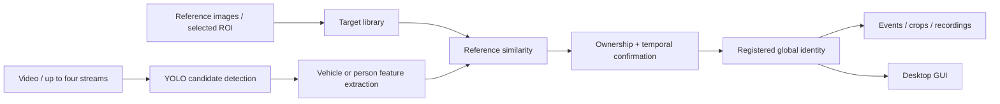

# All of Look Once

**Mark a target. Search its appearances. Follow its identity across streams.**

面向本地离线部署的车辆与人员实例检索原型：上传参考图片或在画面中框选一个具体目标，在完整视频及最多四路视频流中检索该目标，并生成可复核的出现事件。

本项目由 [ljl125887](https://github.com/ljl125887) 设计与维护，重点展示目标登记、检测与重识别组合、时序确认、跨流身份以及证据保存的工程实现。车辆是主要应用方向，人员是辅助分支。

## 能做什么

- **以图找实例**：支持单张参考图，也支持正面、侧面、背面等多张参考图。
- **完整离线检索**：遍历视频，将相邻命中合并为出现事件，保存高分截图和目标切片。
- **多路实时输入**：最多四路 RTSP、HTTP、本地摄像头或循环视频文件，共享本地推理设备。
- **人员互斥归属**：一个检测框在多个登记人员之间竞争归属，减少同时命中多个标签。
- **时序身份保持**：通过多帧证据确认身份，再由短时运动轨迹维持。
- **跨流登记身份**：同一登记目标在各路命中时共用全局 ID，记录其报警出现顺序。
- **证据输出**：报警全图、目标切片、事件 JSON、前后录像；默认手动管理保留期限。
- **桌面 GUI**：图片/视频取帧框选、模型选择、目标启停、四路预览和报警弹窗。

## 系统结构



车辆组合使用 FastReID VeRi、DINOv2 与颜色/形状弱约束。人员可选择 FastReID、OSNet 或融合模式；清晰人脸可额外提供本地 YuNet/SFace 特征。人员模型选择和车辆匹配阈值分别管理。

## 快速开始

建议 Python 3.10+。先安装与本机平台匹配的 PyTorch/torchvision，再安装其余依赖。

```bash
git clone https://github.com/ljl125887/all-of-look-once.git
cd all-of-look-once
python -m venv .venv
# 激活虚拟环境后：
python -m pip install -r requirements.txt
python run.py
```

Linux 的桌面环境可能需要单独安装 Tk 支持。模型未准备时可以打开 GUI，开始推理前须按照 [模型准备说明](docs/MODELS.md) 放置对应权重。仓库不附带模型权重。

1. 选择车辆或人员类别，填写目标名称。
2. 从图片或视频取帧框选目标，尽量减少背景；可继续补充不同角度的参考图。
3. 选择灵敏度与人员模型，保存到目标库。
4. 选择视频执行完整检索，或在实时页填写视频源并启用监控。
5. 查看出现事件与结果目录。停止推理后，已触发的后段录像可能仍需等待完成。

`vehicle_instance_search/config.example.json` 提供空白四路配置。首次保存设置会生成本地 `config.json`。源地址、凭据、参考图和运行结果均留在本机，Git 忽略规则默认排除这些文件。

## 目录

```text
run.py                         桌面启动入口
vehicle_instance_search/
  app.py                       Tk GUI、参考框选与任务调度
  core.py                      检测、离线检索、轨迹及事件汇总
  live.py                      实时采集、身份状态与报警录像
  reid_models.py               车辆/人员特征与相似度计算
  person_osnet.py              OSNet 推理网络
  face_models.py               YuNet / SFace 本地人脸辅助
  profiles.py                  本地目标库
  config.example.json          空白配置模板
docs/                          架构、模型、评估及国产化路线图
tools/check_public_release.py  发布前脱敏检查
tests/                         身份门控与发布边界测试
```

## 当前边界

这是工程原型，实例匹配分数不是身份正确概率。远距离小目标、相同服装、严重遮挡和低分辨率会影响判断，阈值需要在目标部署环境中独立校准。轨迹关联目前采用运动距离与外观证据，不保证交叉遮挡时始终保持身份。

全局 ID 关联的是已登记目标；跨流箭头表示已确认报警的先后顺序，不能单独证明物理运动路径。实时视频当前主要使用 OpenCV CPU 解码和 JPEG 录像缓冲；GPU 视频解码、码流缓存及线程调度仍是优化方向。

仓库提供代码和评估方法。部署精度应通过自己的留出样本验证，参见 [评估协议](docs/EVALUATION.md)。

## 国产化路线

计划评估海光 K100-AI 的模型推理适配、算子兼容性和多路视频性能。**当前处于方案设计阶段，尚未完成实机测试。** CPU/CUDA 之外的设备后端尚未实现。详见 [国产化路线图](docs/DOMESTIC_PORTING.md)。

## 参与与许可

欢迎通过 Issue 提交可复现的问题，或通过 Pull Request 改进设备适配、轨迹关联和测试覆盖。分享项目时可引用仓库链接并保留作者署名。

应用原创代码使用 [GNU AGPL-3.0](LICENSE)，配合 Ultralytics 依赖的开源许可。第三方派生代码、依赖和模型权重各自保留其许可证与署名，参见 [第三方说明](vehicle_instance_search/THIRD_PARTY_NOTICES.md)。
